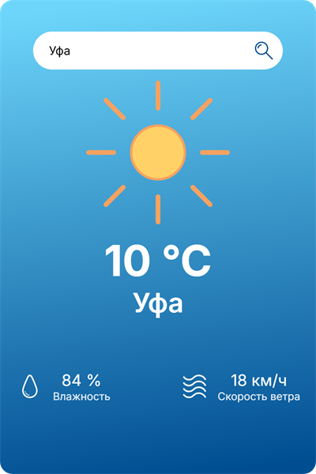
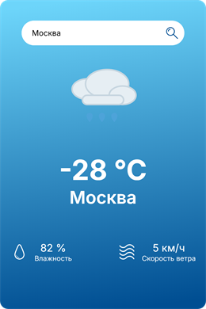
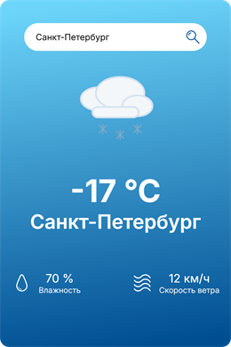
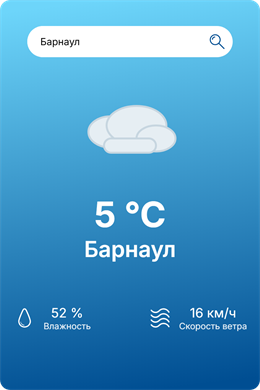
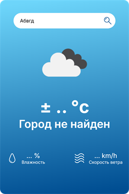

<h1 align="center">Offline Weather Widget</h1>

<p align="center">
  <b>Виджет погоды для 100 городов России на HTML, CSS и JavaScript: работает без интернета и без платных API.</b>
</p>

<p align="center">
  
  
  
  
  <a href="https://dekciw.github.io/offline-weather-widget/"></a>
</p>

<p align="center">
  <a href="https://dekciw.github.io/offline-weather-widget/">
    
  </a>
</p>

<br>

<table align="center">
  <tr>
    <td width="50%" valign="top">
      
    </td>
    <td width="50%" valign="top">
      <h3>Что показывает</h3>
      <ul>
        <li><b>Температуру</b> в градусах Цельсия</li>
        <li><b>Влажность</b> в процентах</li>
        <li><b>Скорость ветра</b> в км/ч</li>
        <li><b>Иконку погоды</b>: солнце, облака, дождь, снег или ветер</li>
      </ul>
      <h3>Что умеет</h3>
      <ul>
        <li><b>Ищет город</b> по названию без учёта регистра</li>
        <li><b>Сообщает «Город не найден»</b>, если такого города нет в списке</li>
        <li><b>Работает офлайн</b>: данные о погоде лежат в самом проекте</li>
      </ul>
      <h3>Как попробовать</h3>
      <p>Открой <a href="https://dekciw.github.io/offline-weather-widget/">живое демо</a> и введи, например, «Москва», «Сочи» или «Уфа».</p>
    </td>
  </tr>
</table>

<h3 align="center">Как это выглядит</h3>

<table align="center">
  <tr>
    <td align="center"><br><sub>Дождь</sub></td>
    <td align="center"><br><sub>Снег</sub></td>
    <td align="center"><br><sub>Облачно</sub></td>
    <td align="center"><br><sub>Город не найден</sub></td>
  </tr>
</table>

<br>

<details>
<summary><b>Подробнее о проекте: как это работает, запуск, структура</b> (нажми, чтобы развернуть)</summary>

<br>

## Содержание

- [Как это работает](#как-это-работает)
- [Запуск](#запуск)
- [Как добавить свой город](#как-добавить-свой-город)
- [Структура проекта](#структура-проекта)
- [Цели проекта](#цели-проекта)

## Как это работает

1. Пользователь вводит название города и нажимает Enter или кнопку поиска.
2. `script.js` перехватывает отправку формы (`event.preventDefault()`), чтобы страница не перезагружалась.
3. В массиве `cities` из `russianWeatherData.js` ищется город с таким же названием без учёта регистра.
4. Если город найден, в карточку подставляются температура, влажность, ветер, название и иконка `img/<icon>.svg`.
5. Если нет, вместо названия города выводится «Город не найден».

Данные демонстрационные и не меняются: это учебный проект, а не прогноз погоды.

## Запуск

Сборка и зависимости не нужны, но **открыть `index.html` двойным кликом не получится**: скрипты подключены как ES-модули, а браузер не загружает модули из локального файла. Запусти любой локальный сервер в папке проекта:

```bash
git clone https://github.com/dekciw/offline-weather-widget.git
cd offline-weather-widget
npx serve .            # или: python -m http.server 8000
```

Затем открой адрес, который покажет сервер. В VS Code для этого подойдёт расширение Live Server.

## Как добавить свой город

Добавь объект в массив `cities` в файле `russianWeatherData.js`:

```js
{
	city: 'Кисловодск',
	temperature: 12,   // °C
	humidity: 60,      // %
	wind: 4,           // км/ч
	icon: 'sun',       // sun, cloud, rain, snow или wind
},
```

Значение `icon` должно совпадать с именем файла в папке `img/`.

## Структура проекта

```
.
├── index.html               # разметка карточки: поиск, погода, влажность и ветер
├── style.css                # стили карточки
├── script.js                # поиск города и вывод данных
├── russianWeatherData.js    # массив cities с данными о погоде
├── img/                     # иконки погоды и интерфейса (SVG)
├── fonts/                   # шрифт Inter (локально, работает без интернета)
└── assets/                  # скриншоты для README
```

## Цели проекта

Проект сделан как тренировочный, чтобы попрактиковаться в:

- работе с DOM: поиск элементов и обновление содержимого;
- обработке формы поиска;
- условном выводе: данные о погоде или сообщение «Город не найден»;
- работе с массивом объектов;
- подключении нескольких JS-файлов через ES-модули.

</details>

<!-- Pull Shark 1 -->

<!-- Pull Shark 2 -->
